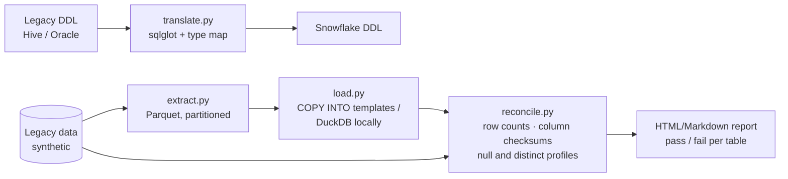

# legacy-to-snowflake-migration-kit

 

A small, opinionated toolkit for moving Hive- and Oracle-style tables to Snowflake. It handles DDL translation, Parquet extracts and loading, and proves the move worked with reconciliation reports. Locally the target is DuckDB, so the whole flow runs without a Snowflake account; Snowflake templates are included.

> Fictional source system: **Bayou Retail's** legacy warehouse (synthetic Hive and Oracle schemas in `samples/`).

## Architecture


## Run it in three commands
```bash
make setup   # python venv + deps
make demo    # translates 12 sample tables, migrates to DuckDB, writes reports/reconciliation.md
make test    # pytest: type mapping, DDL translation, reconciliation edge cases
```

## What is inside
```
src/migrate/{translate.py,typemap.py,extract.py,load.py,reconcile.py,cli.py}
samples/{hive_ddl,oracle_ddl,data}
templates/snowflake/{file_format.sql,stage.sql,copy_into.sql.j2}
docs/cutover-checklist.md     # freeze, delta load, reconcile, switch readers, rollback plan
```

## What it proves
- A repeatable migration method: translate, load, then **prove** with reconciliation rather than eyeballing
- Snowflake loading patterns (stages, file formats, COPY INTO)
- Edge cases handled: Oracle `NUMBER` precision, `DATE` vs `TIMESTAMP`, Hive partitions, complex types

## Limitations
- Stored procedures, PL/SQL and HiveQL UDF logic are out of scope; they are flagged for manual rewrite.
- The reconciliation report is Markdown only (no HTML output).
- `make demo` deliberately skips one Parquet file of `PRODUCT_RETURNS` during the load, so the report shows 11 PASS and 1 FAIL; the command succeeds only when exactly that table fails.
- The Snowflake path is rendered, not executed: `make demo` writes DDL and `COPY INTO` scripts to `build/snowflake/` (the DDL is syntax-checked with sqlglot in tests), but nothing runs against a live Snowflake account here or in CI.

## About the author
Built by Gopi Dodda, Senior Data Engineer: [LinkedIn](https://www.linkedin.com/in/gopidodda6091/). Original work on synthetic data.
